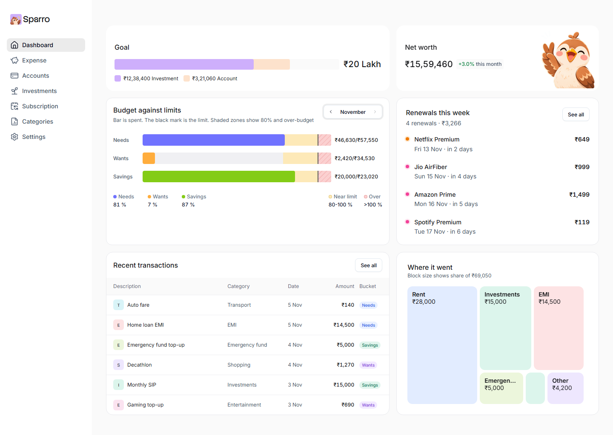
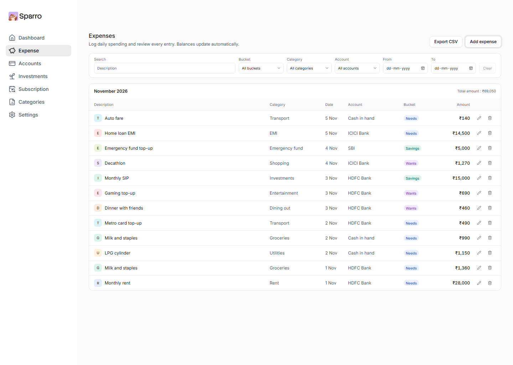
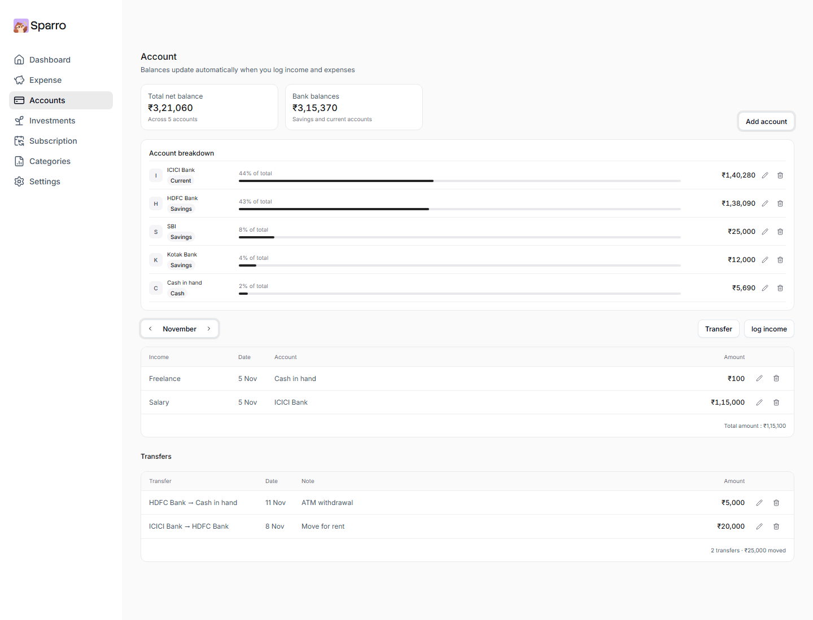
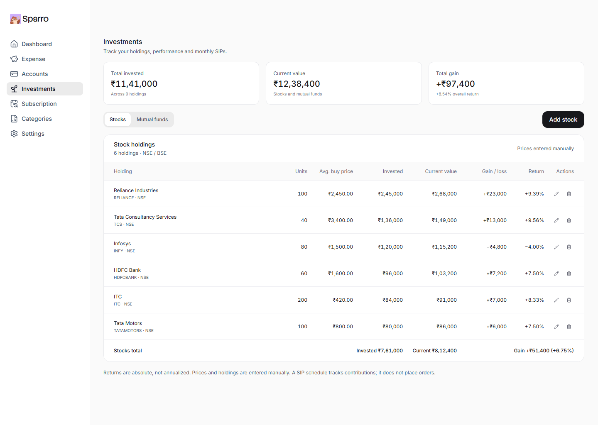
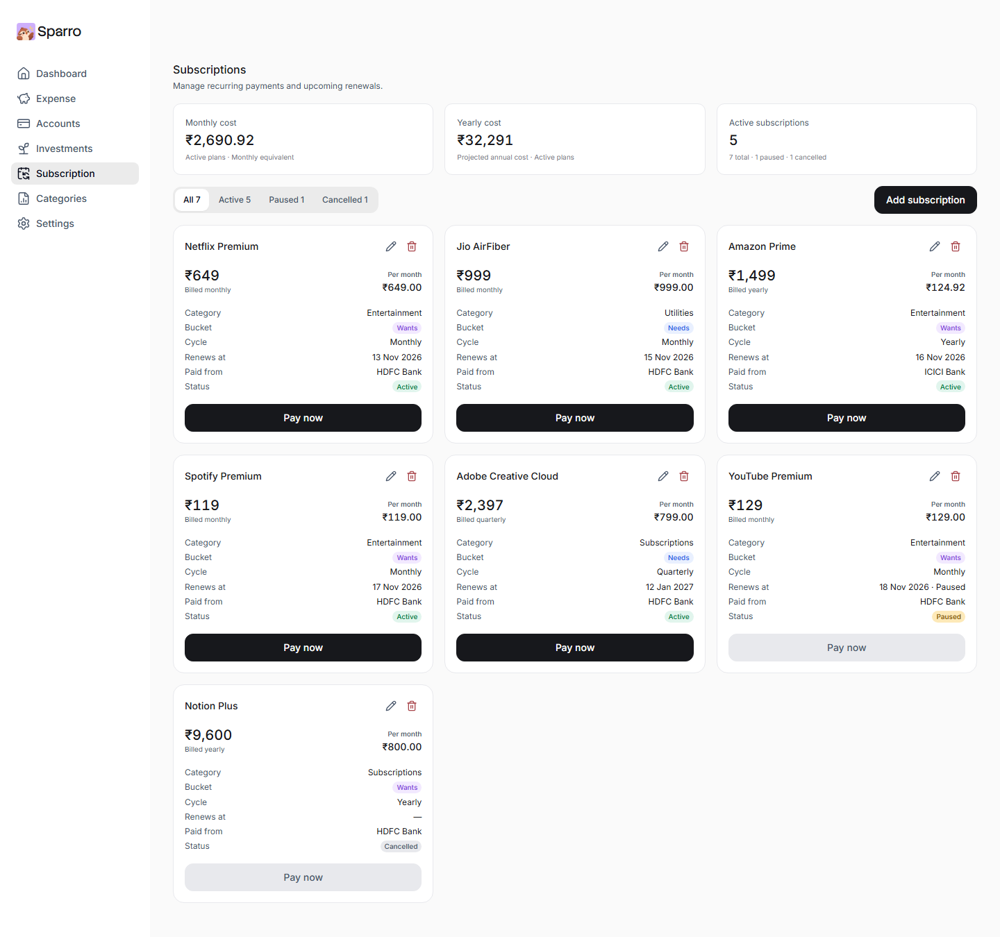
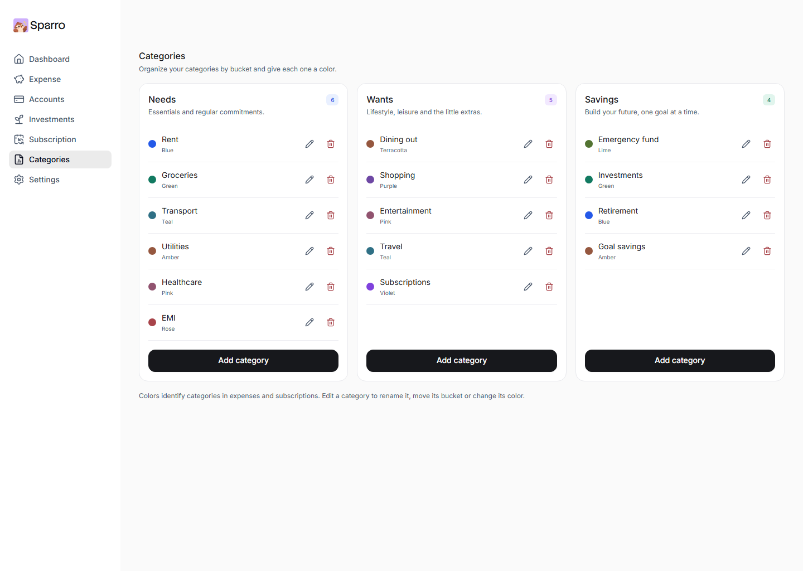
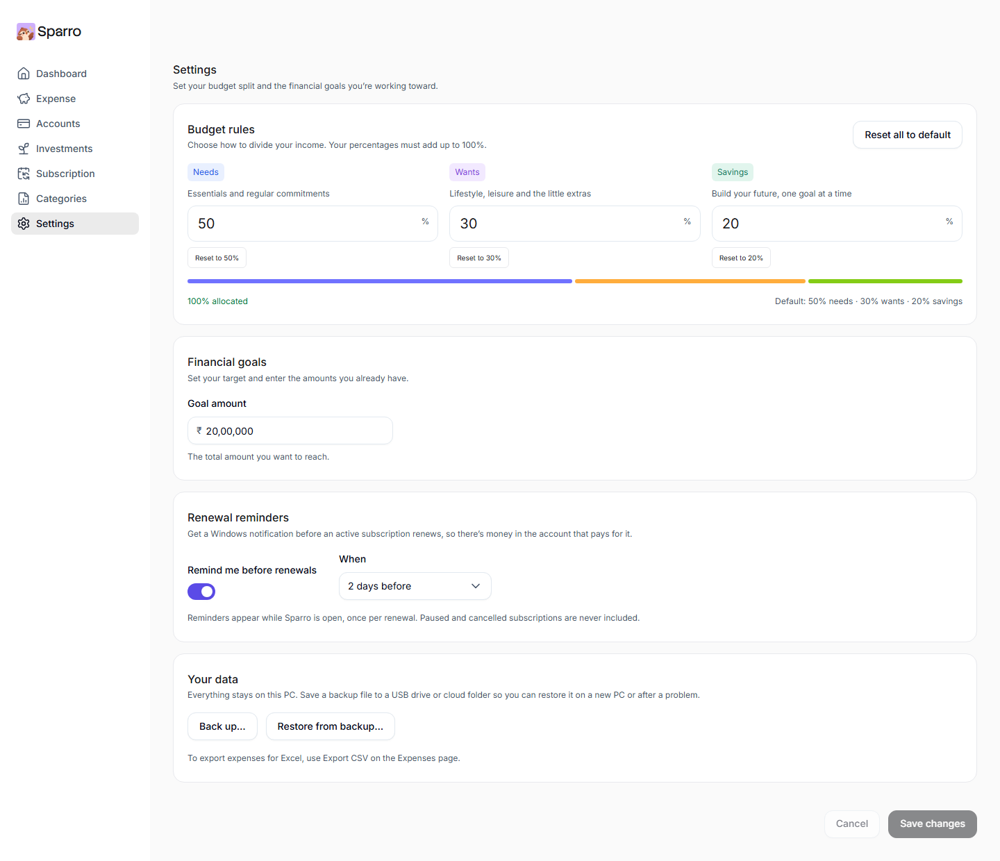

# Sparro

Private, offline budgeting for Windows. Track expenses, income, accounts, transfers, investments and subscriptions against a Needs / Wants / Savings budget. Your data never leaves your PC.



## Download

Get the latest installer from [Releases](https://github.com/ShaikMoosa/Sparro/releases/latest):

- **`Sparro_x.y.z_x64_en-US.msi`**: standard Windows installer (recommended).
- **`Sparro_x.y.z_x64-setup.exe`**: alternative installer that doesn't need admin rights.

Works on Windows 10 (22H2+) and Windows 11. On Windows 10 the installer downloads Microsoft WebView2 if it's missing.

> The installers are not code-signed yet, so Windows SmartScreen may show "Windows protected your PC". Choose **More info → Run anyway**.

Your data lives in `%APPDATA%\com.sparro.app\sparro.db` (a single SQLite file).

- **Back up / restore:** Settings → Your data saves a `.sparro` backup file, or restores one (replacing current data).
- **CSV export:** Expenses → Export CSV saves the entries matching your current filters, ready for Excel.
- **Renewal reminders:** while Sparro is open, Windows notifies you 1–7 days (default 2) before an active subscription renews. Turn it off or change the timing in Settings.

## Screenshots

<table>
  <tr>
    <td width="50%"><b>Expenses</b>: filter by bucket, category, account and dates; export to CSV.<br><br></td>
    <td width="50%"><b>Accounts</b>: balances, monthly income and transfers between accounts.<br><br></td>
  </tr>
  <tr>
    <td width="50%"><b>Investments</b>: stocks and mutual funds with gain, return and monthly SIPs.<br><br></td>
    <td width="50%"><b>Subscriptions</b>: monthly and yearly cost, renewal dates and Pay now.<br><br></td>
  </tr>
  <tr>
    <td width="50%"><b>Categories</b>: organised by bucket, each with its own colour.<br><br></td>
    <td width="50%"><b>Settings</b>: budget split, goal, renewal reminders, backup and restore.<br><br></td>
  </tr>
</table>

<sub>Screenshots show sample data.</sub>

## What's inside

| Layer | Technology |
| --- | --- |
| App shell | [Tauri 2](https://tauri.app) (Rust + WebView2) |
| Backend | Rust, SQLite via `rusqlite` (bundled), money stored as integer paise |
| Frontend | React 19 + TypeScript, [React Aria Components](https://react-spectrum.adobe.com/react-aria/) for accessible controls |
| Data | TanStack Query; TypeScript types generated from Rust with `ts-rs` (`src/bindings`) |
| Design | Tokens copied from the Sparro Figma variables (`src/styles/tokens.css`) |

```
src-tauri/
  migrations/      SQL schema (versioned with PRAGMA user_version)
  src/service/     business rules (accounts, ledger, subscriptions, investments, dashboard, …)
  src/commands.rs  thin Tauri commands
  src/tests.rs     service tests against an in-memory database
src/
  api/             typed client; mock.ts powers browser previews and component tests
  components/      shared accessible UI (dialogs, fields, empty states, …)
  pages/           one file per screen
  styles/          tokens, base, components, pages
```

## Accessibility

Sparro targets **WCAG 2.2 AA**:

- Every page is scanned with axe in CI, with sample data and on a first run (`src/test/a11y.test.tsx`).
- Colour pairs meet 4.5:1 for text. The success green was darkened in Figma to pass.
- Everything works with the keyboard, with a visible focus ring. Dialogs trap focus and return it when closed.
- Row actions have 24 px+ hit areas and spoken names ("Edit Home loan EMI").
- Budget zones aren't colour-only: the over-budget zone is hatched and bars carry text alternatives.
- Charts have screen-reader tables. The app respects reduced motion and Windows high-contrast.

## Develop

Requirements: Node 20+, Rust (stable, MSVC), Visual Studio Build Tools with C++.

```bash
npm install
npm run tauri dev        # desktop app with the real Rust backend
npm run dev              # browser preview at http://localhost:1420 using in-memory sample data
```

Checks:

```bash
npm run typecheck
npm test                 # Vitest: formatting + axe accessibility scans
cd src-tauri && cargo test   # Rust service tests (also regenerates src/bindings)
```

Build installers locally:

```bash
npm run tauri build      # → src-tauri/target/release/bundle/{msi,nsis}/
```

## Releasing

Push a version tag. The **Release** workflow builds the MSI and setup.exe on Windows and attaches them to a GitHub Release:

```bash
git tag v0.1.0
git push origin v0.1.0
```

Keep `version` in `package.json`, `src-tauri/Cargo.toml` and `src-tauri/tauri.conf.json` in step with the tag.
